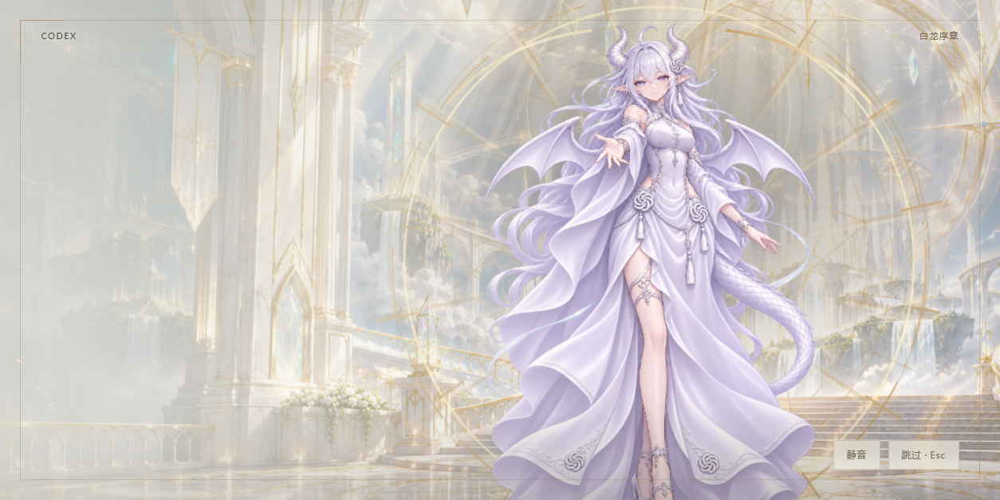

# Codex 白龙娘启动动画

一个独立的 Windows 启动入口：播放白龙娘变身动画，同时启动 Microsoft Store 版 Codex。动画结束后，画面渐隐并切换至最大化的 Codex 窗口。

这是非官方个人项目，与 OpenAI 及角色原作者没有官方关联。

## 效果预览

**变身时刻**

**白龙娘形态**

## 使用要求

- Windows，安装在默认位置的 Microsoft Edge。
- Microsoft Store 版 Codex：启动器使用其应用标识打开应用，并按 Store 安装路径识别窗口。其他安装方式未测试。
- Windows PowerShell 和 Windows Script Host（Windows 通常自带）。

## 使用

1. 从 GitHub 下载项目并完整解压，保留文件的相对位置。
2. 双击 `Install-Codex.vbs`，按提示完成安装。安装程序会将运行文件复制到 `%LOCALAPPDATA%\CodexWhiteDragon` 下的版本目录，并在桌面创建启动快捷方式及设置图标；如果默认安装目录已被其他文件占用，会自动选择带编号的目录。
3. 双击桌面的「Codex 白龙启动」快捷方式，播放动画并启动 Codex。按 `Esc` 可以跳过动画；Codex 准备好后自动进入。
4. 双击项目中的 `Preview-Animation.vbs` 可单独预览，不启动 Codex。按 `Esc` 退出预览。

更新版本时，重新解压并运行 `Install-Codex.vbs`。安装程序会保留旧版本并更新它自己创建的桌面快捷方式。如果桌面已有同名的其他快捷方式，安装程序会使用其他名称，避免覆盖它。

动画约 12 秒；Codex 加载较慢时，动画结束后的等待画面会继续显示。系统启用减少动态效果时，动画会缩短。动画覆盖 Codex 所在的显示器，Codex 使用 Windows 最大化窗口，保留系统标题栏和任务栏。

也可以直接在浏览器中打开 `animation.html` 预览网页动画，但它不会启动 Codex。普通浏览器可能限制自动播放声音，可使用画面上的声音按钮。

## 工作方式与排查

- 启动器使用独立的 Edge 配置目录 `%LOCALAPPDATA%\CodexStartupEffect\EdgeProfile`。启动阶段日志保存在 `%LOCALAPPDATA%\CodexStartupEffect\launcher.log`；日志记录启动阶段和窗口诊断信息，不记录聊天内容。
- 为判断何时切换，启动器通过 Windows 辅助功能检查 Codex 输入框是否可用，不读取输入内容。如果检测不到，会在等待一段时间后退出动画。此检查不能保证网络或后台加载已经完成。
- 如果动画未出现，请确认 Edge 在默认安装位置、已安装 Microsoft Store 版 Codex，并查看上述日志。如果启动器检测到你切换到其他应用，可能不显示动画，以免覆盖当前操作。
- 安装及启动入口运行的 PowerShell 使用 `-ExecutionPolicy Bypass` 启动对应脚本进程，不修改系统全局执行策略。
- 项目不会修改官方应用安装包或聊天数据，也不会替换原有 Codex 入口。停止使用时，可删除安装时创建的桌面快捷方式和安装完成提示中显示的安装目录；如不再需要，也可手动删除上述 Edge 配置和日志目录。

## 文件

| 文件 | 用途 |
| --- | --- |
| `Install-Codex.vbs`、`install.ps1` | 一键安装及桌面快捷方式创建 |
| `Start-Codex-Animation.vbs` | 动画启动入口 |
| `Preview-Animation.vbs` | 独立预览入口 |
| `launcher.ps1` | 窗口协调、启动和切换逻辑 |
| `animation.html` | 动画画面与合成音效 |
| `celestial-background.png` | 背景 |
| `character-before.png` | 变身前立绘 |
| `character-dragon.png` | 变身后立绘 |
| `white-dragon-icon.ico` | 可选的快捷方式图标 |
